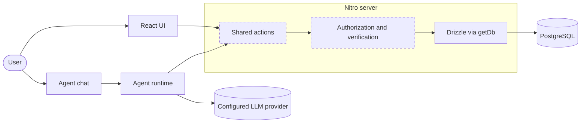

# Pactlane

**From meeting promises to measurable progress.**

Pactlane is an AI-native commitment manager for small teams. It turns meeting conversations into verifiable commitments, then follows each one across later meetings so nothing quietly slips.

> **Status: Phases 0 to 3 built locally.** A person can store meetings, save an analysis with server-verified evidence, correct and review commitments, and follow one commitment across meetings by confirming suggested links. **Agent proposals, undo and follow-ups are not built, and no real model has run extraction or matching.** See [Current completion status](#current-completion-status).

| Read this | For |
| --- | --- |
| [docs/ARCHITECTURE.md](docs/ARCHITECTURE.md) | System design, domain model, proposed actions, invariants |
| [docs/DEPLOYMENT.md](docs/DEPLOYMENT.md) | Cloudflare and Supabase runbook, risks, smoke tests |
| [docs/ROADMAP.md](docs/ROADMAP.md) | Phases, cut lines, the hackathon deadline |
| [docs/DECISIONS.md](docs/DECISIONS.md) | Why the architecture is the way it is |
| [docs/DEMO.md](docs/DEMO.md) | The three-meeting demo and submission requirements |
| [docs/IDEAS.md](docs/IDEAS.md) | Parking lot for future ideas |
| [AGENTS.md](AGENTS.md) | Rules the in-app agent and coding agents follow |

## Contents

- [Product](#product)
- [Features](#features)
- [Technical architecture](#technical-architecture)
- [Development architecture](#development-architecture)
- [Setup](#setup)
- [Deployment](#deployment)
- [Project execution](#project-execution)

---

## Product

### The problem

Meetings produce decisions, promises, deadlines and responsibilities. Once the meeting ends, those commitments are forgotten, misunderstood, reassigned without context or repeatedly delayed. Nobody can easily answer, "Didn't we already agree on this three weeks ago?"

### Who it is for

Student project teams, hackathon teams, early-stage startups and other small collaborative teams. These groups meet often, have no project manager, and feel a slipped commitment immediately.

### Value proposition

For any commitment, Pactlane should answer:

1. What exactly was decided?
2. Who is responsible for it?
3. When is it due?
4. What evidence supports it?
5. Was it discussed again?
6. Has it been delayed, changed or completed?
7. What should the team do next?

### How it differs from AI meeting assistants

| Traditional meeting assistant | Pactlane |
| --- | --- |
| Summarizes one meeting | Tracks one commitment across many meetings |
| Produces a list of action items | Maintains commitments with stable identities |
| Asks you to trust the summary | Links each claim to a transcript quote the server checks |
| Each meeting starts from zero | A new meeting updates existing commitments |
| AI output is the end result | The agent proposes, and people approve, edit, reject or reverse |

### Long-term mission

Become an intelligent accountability workspace where people and AI work together so commitments turn into outcomes.

### Commitment Trail

Commitment Trail is the signature feature: a continuous, traceable history of each commitment across meetings.

> **Meeting 1:** The team agrees Aarav will prepare a presentation before Friday.
> **Meeting 2:** It is unfinished. Aarav asks for two more days.
> **Meeting 3:** It is still incomplete.

Pactlane should identify the original commitment, link it to its original evidence, recognize it is unfinished, show the sequence, detect the repeated delay and ask for a decision:

> "The presentation commitment has remained unfinished across three meetings. Aarav previously requested an extension. Would you like to reassign part of the work or adjust the deadline?"

### Primary user journey (eventual MVP)

1. Open Pactlane and select or create a project.
2. Create a meeting and paste notes or a transcript, or upload a supported text file.
3. The agent analyzes the transcript.
4. Pactlane extracts a summary, decisions, commitments, owners, deadlines, priorities, source evidence and uncertainties that need review.
5. Commitments appear in an editable workspace, each able to open its source evidence.
6. The user corrects owners, deadlines, descriptions and statuses. Changes persist with an audit trail.
7. Later meetings update the same commitments instead of duplicating them.
8. Pactlane identifies unfinished work, delays and repeated carry-over.
9. The agent proposes solutions, and users approve, edit, reject or reverse them.
10. Pactlane prepares follow-up drafts and the next meeting agenda.

### Human-agent collaboration

The agent interprets and proposes. Deterministic server code verifies and authorizes. People decide.

Trust and accountability principles:

- **Never invent.** Unknown owners and dates stay unknown.
- **Show the source.** A claim links to the words that support it.
- **Verified means server-verified.** Unverified evidence is never shown as verified.
- **Facts, proposals and completed actions look different.**
- **Every meaningful change is attributable** to a person, the agent or the system.
- **People stay in control** of sensitive changes and anything sent to others.

### Design direction (future phases)

Premium, minimal, calm, intelligent, modern, clear, purposeful and trustworthy. The interface should make it immediately obvious what is happening, what needs attention, what the agent discovered, what was verified, what changed and what the user controls. Commitment Trail should become the visual centerpiece. No custom design system is planned for the hackathon.

---

## Features

All of these are **planned**. Nothing in this section is implemented yet.

| Tier | Feature |
| --- | --- |
| **Essential MVP** | Projects and meetings; transcript paste; agent extraction; commitments with owner, due date, priority and status; source evidence with server verification; editable workspace; audit trail |
| **Hackathon differentiators** | Commitment Trail across meetings; duplicate-free matching to existing commitments; slippage and carry-over detection; agent proposals with approve, edit, reject; visible history and undo |
| **Post-MVP** | Follow-up delivery; next-meeting agenda; team collaboration; calendar and chat integrations; analytics |
| **Experimental** | See [docs/IDEAS.md](docs/IDEAS.md) |

---

## Technical architecture

### Stack

| Concern | Choice | State |
| --- | --- | --- |
| Framework | Agent-Native 0.226.0, standalone Chat template | Installed and running |
| UI and routing | React 19, React Router 8, Vite, Tailwind, shadcn/ui | From template |
| Server | Nitro | From template |
| Language | TypeScript, strict | Typecheck passes |
| Database | PostgreSQL through Drizzle ORM | Schema implemented |
| Local database | PGlite at `data/pglite` | Migrated and validated |
| Production database | Supabase PostgreSQL | **Not provisioned** |
| Authentication | Framework Better Auth integration | From template, unchanged |
| Validation | Zod at actions, database constraints | Constraints implemented |
| Hosting | Cloudflare Workers, Vercel as fallback | Build and dry run only, **not deployed** |
| AI | Framework agent runtime, replaceable provider | **No provider configured or tested** |

### High-level architecture

Dashed boxes do not exist yet.



### How the pieces communicate

- **UI to actions.** Components call `useActionQuery` and `useActionMutation`, which hit `/_agent-native/actions/<name>`. Components never write to the database.
- **Agent to actions.** Each file in `actions/` is discovered automatically and exposed to the agent as a tool described by its Zod schema. The agent and UI share one business operation.
- **Storage.** Domain data lives in PostgreSQL, using PGlite locally and Supabase in production. The framework's own tables share the same database.
- **Synchronization.** After each side-effecting tool call, the chat run invalidates affected action queries, so agent edits appear without custom sync code. Long-lived hosts use server-sent events; production serverless uses `/_agent-native/poll`.
- **Source verification (planned).** The server loads the stored transcript and checks each proposed quote against it. Details are in [ARCHITECTURE.md](docs/ARCHITECTURE.md#source-verification).
- **Authentication and authorization.** Better Auth owns sign-in. Actions receive the trusted identity as `ctx.userEmail` and `ctx.orgId`. Projects are registered as shareable resources, private by default and never link-public. Every project action checks access itself, and a missing project and a forbidden one give the same answer.

---

## Development architecture

### Directory structure

```text
actions/              Shared operations for UI and agent (template examples only so far)
app/                  React routes and components (template)
server/
  db/
    schema.ts         Drizzle table definitions
    migrations.ts     SQL history: constraints, foreign keys, indexes
    index.ts          getDb, sharing and identity registration
    schema.test.ts    Business invariants against real SQL
  plugins/db.ts       Applies migrations through the framework
  plugins/agent-chat.ts  Agent runtime configuration
shared/domain.ts      Allowed status values for client and server
scripts/migrate-production.ts  Release-step migration (template)
docs/                 Architecture, roadmap, decisions, demo, ideas
AGENTS.md             Agent rules, loaded every turn
```

### Module responsibilities

Pactlane is a modular monolith. These are logical boundaries, not packages or services, and only their tables exist today.

| Module | Owns |
| --- | --- |
| projects | Grouping, ownership and sharing |
| people | Participants and aliases, with or without accounts |
| meetings | Transcripts, summaries and processing state |
| commitments | Stable commitment records and their status |
| evidence | Transcript quotes and verification state |
| ledger | The `changes` history and future undo |
| followups | Drafts and their approval |

### Database overview

Eight tables: `projects`, `project_shares`, `people`, `meetings`, `commitments`, `commitment_evidence`, `changes` and `followups`. Full design and the invariant table are in [ARCHITECTURE.md](docs/ARCHITECTURE.md#database-architecture).

### Shared action design

A few well-validated actions rather than one per field. The proposed list is in [ARCHITECTURE.md](docs/ARCHITECTURE.md#shared-actions). None are implemented yet.

### Error handling

- Expected failures use the framework's `fail(message, { errorCode, statusCode })`.
- A bare `throw new Error()` reaches clients as a generic 500, so it is reserved for true bugs.
- Never return `{ error }` as a normal result: the framework counts that as success.
- Report failures honestly. The agent may claim success only after persistence is confirmed.

### Testing strategy

Focused tests for business invariants using the template's Vitest, with no added framework. `server/db/schema.test.ts` runs the real migration SQL on an in-memory PGlite database, covers each constraint, and fails if Drizzle or the shared status lists drift from the SQL.

---

## Setup

### Prerequisites

- Node.js 22.22 or newer (validated on 24.18.0)
- pnpm 10.29.1, supplied by Corepack from `packageManager` in `package.json`

### Installation

```bash
corepack enable
pnpm install
```

On Windows, `corepack enable` needs an elevated terminal because it writes to `Program Files`. Without elevation, prefix each command with Corepack, such as `corepack pnpm install`. A global pnpm 9 fails with `packages field missing or empty`.

### Environment

```bash
cp .env.example .env
```

Local development needs no variables. To use the agent, set one provider key in `.env` or connect a provider in the app. Never commit `.env`.

### Local development

```bash
pnpm dev
```

The app starts on port 8080, or the next free port, and opens a browser. Choose **Continue as local dev** on the welcome screen.

### Database initialization

Nothing to run. With `DATABASE_URL` unset, the framework uses PGlite at `data/pglite` and applies `server/plugins/db.ts` at startup. To add a schema change, append a named entry to `server/db/migrations.ts` and update `server/db/schema.ts`.

### Commands

| Command | Purpose |
| --- | --- |
| `pnpm dev` | Development server |
| `pnpm build` | Production build for Node |
| `pnpm start` | Run the production build |
| `pnpm typecheck` | Type-check |
| `pnpm test` | Run tests |
| `pnpm agent-native:doctor` | Framework guards |
| `pnpm action <name>` | Run an action from the command line |
| `pnpm migrate:production` | Apply migrations to the configured database |

The template has no lint script. Formatting uses `oxfmt`.

The Agent-Native CLI collects anonymous usage data. Opt out with `npx @agent-native/core telemetry disable`.

---

## Deployment

**Nothing has been deployed.** The complete runbook is [docs/DEPLOYMENT.md](docs/DEPLOYMENT.md). In short:

| Topic | Approach |
| --- | --- |
| Hosting | Worker built with `NITRO_PRESET=cloudflare_module`, config generated at `.output/server/wrangler.json` |
| Runtime database | Supabase transaction pooler, port 6543, as `DATABASE_URL` |
| Migrations | Release step `pnpm migrate:production` over a direct or session connection, never in request handling |
| Secrets | `wrangler secret put`, never committed |
| Fallback | `NITRO_PRESET=vercel` with `vercel deploy --prebuilt --prod` |

Workers Paid is effectively required: the free plan's 10 ms CPU limit cannot run agent work.

---

## Project execution

### Current completion status

Evidence recorded 2026-11-09.

| Item | State |
| --- | --- |
| Chat template scaffold, dependencies, lockfile | **Validated** |
| Documentation | **Implemented** |
| Schema and migrations v1 to v4 | **Validated** on PGlite, and v3 and v4 through the framework's migration runner on a copy of a database that already held v2 data |
| Tests | **Validated**, 236 passing: schema, actions, access control, the real agent loop with a scripted model, health, matching and interface logic |
| Typecheck, framework doctor | **Validated** |
| Node and Cloudflare builds | **Validated**, not deployed. Wrangler dry run last run in Phase 0 |
| Project access checks in actions | **Implemented** and tested, including denial for other users and viewers |
| Meeting storage, analysis saving, server evidence verification | **Implemented** and tested with controlled input |
| Commitment editing, review, participants, history, meeting workspace | **Implemented**. Browser-tested on a database copy, with a second user denied |
| Project ledger, candidate search, human-confirmed links, derived health, Commitment Trail | **Implemented**. Browser-tested across three meetings on a database copy. Matching is deterministic |
| Agent rules | **Implemented**. A real model's behavior is untested because none is configured |
| AI agent execution | **Blocked** on a provider credential. No real extraction has been run |
| Supabase connection and migration | **Blocked** on a Supabase project |
| Worker runtime behavior | **Blocked** on Cloudflare account and database |
| Agent proposals, undo, follow-ups | **Planned** |

### Roadmap

See [docs/ROADMAP.md](docs/ROADMAP.md). Phases: 0 Foundation, 1 Meeting Intelligence, 2 Evidence Workspace, 3 Commitment Trail, 4 Agent Collaboration, 5 Polish and Submission.

### Acceptance criteria for the MVP

- A pasted transcript produces commitments with evidence the server has checked.
- Unknown owners and dates stay empty and are flagged for review.
- A second meeting updates an existing commitment instead of duplicating it.
- A repeated delay is detected and produces a proposal a person can approve or reject.
- Every change shows who made it and can be reviewed.

### Risks and limitations

- **The submission deadline is 2026-11-09, 11:59 PM PT.** Agent proposals are not built. See the [roadmap's critical path](docs/ROADMAP.md#deadline-and-critical-path).
- No real model has produced an analysis or used the ledger. Extraction quality, verbatim quoting and prompt-injection resistance are unverified.
- Candidate matching compares words and names, so it can miss a paraphrase. A person can link by hand.
- Worker runtime is unproven: only the build and dry run passed. See [DEPLOYMENT.md](docs/DEPLOYMENT.md#risk-analysis).
- A meeting's first saved analysis cannot be replaced yet. Decisions can be read but not edited or resolved.

### Demo plan

[docs/DEMO.md](docs/DEMO.md) describes three connected meetings that show extraction, correction, carry-over, a proposal, approval and history.

### Future expansion

Team collaboration, calendar and chat integrations, analytics and agenda generation. See [docs/IDEAS.md](docs/IDEAS.md).

---

Built on the [Agent-Native](https://www.agent-native.com/docs/) Chat template.
