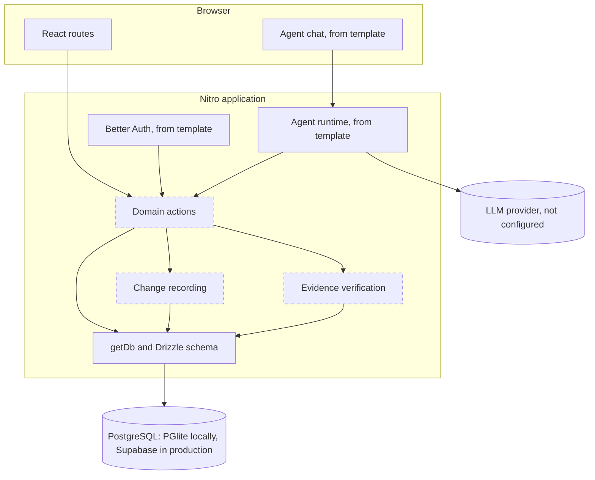
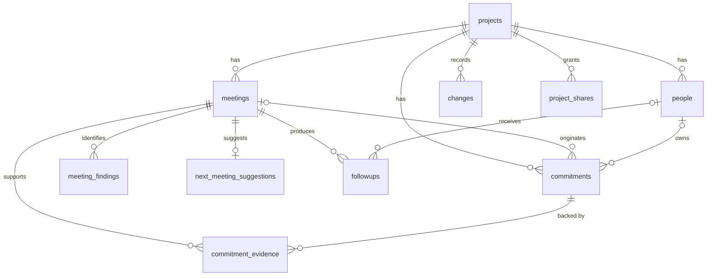
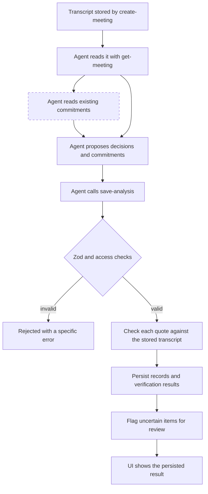
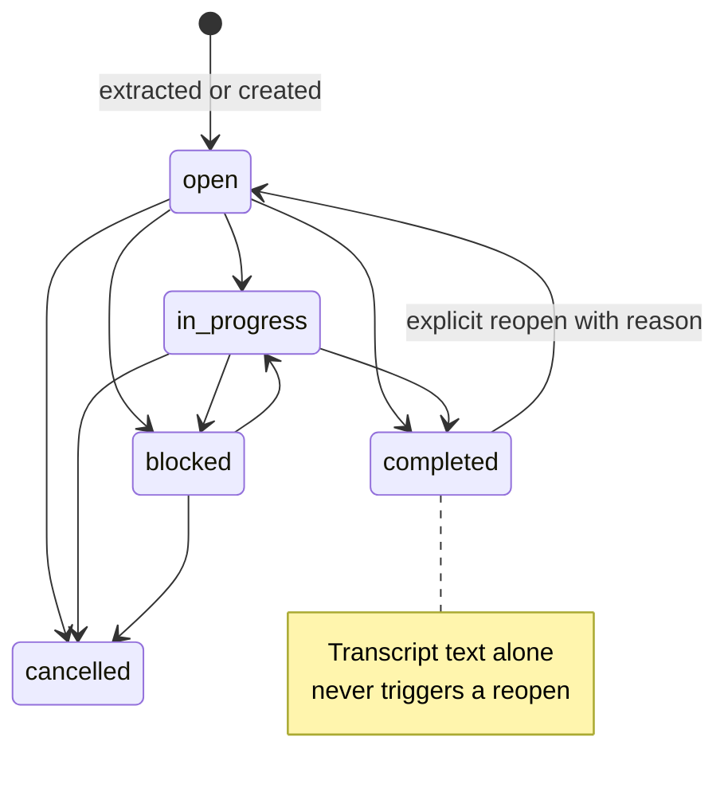
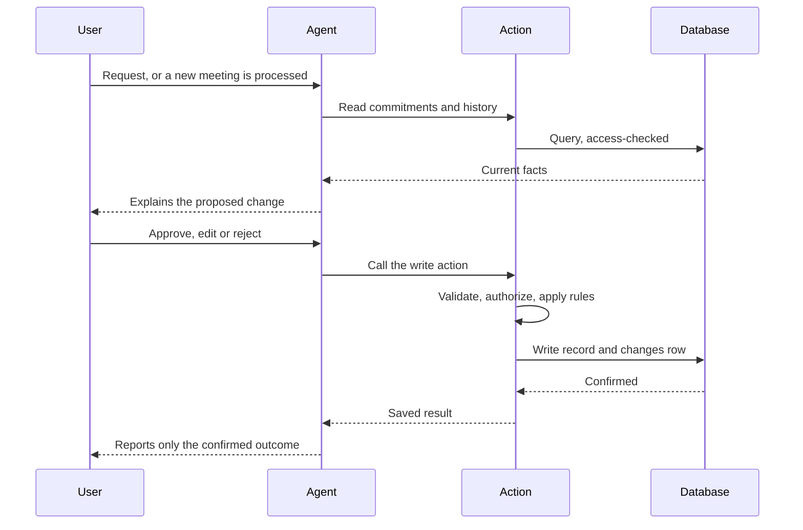
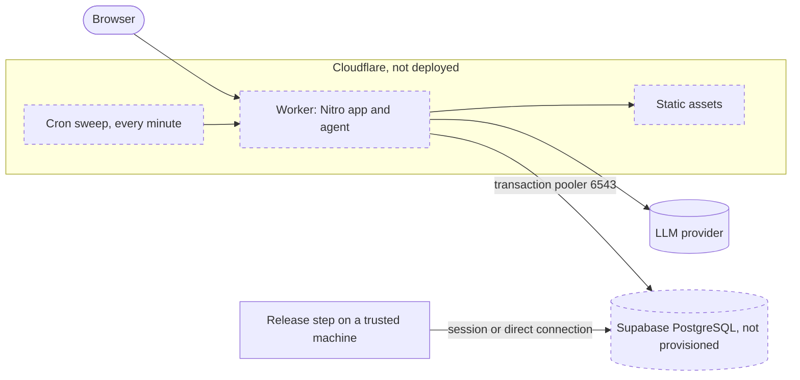

# Architecture

Status as of 2026-11-09, Phase 5 Checkpoint 1. **Implemented** means the code exists now. Everything else is a design for later phases. In diagrams, dashed boxes have not been built.

Framework details were checked against Agent-Native 0.226.0: its documentation, the generated template and the installed package source.

## Modular monolith

One deployable application, organized by domain. There are no separate services, brokers, caches or vector stores. Modules are logical boundaries inside one codebase:

| Module | Tables | State |
| --- | --- | --- |
| projects | `projects`, `project_shares` | Tables implemented |
| people | `people` | Table implemented |
| meetings | `meetings`, `meeting_findings`, `next_meeting_suggestions` | Tables implemented |
| commitments | `commitments` | Table implemented |
| decisions | `decisions` | Table implemented |
| evidence | `commitment_evidence`, `decision_evidence`, `meeting_finding_evidence`, `next_meeting_evidence` | Tables implemented |
| ledger | `changes` | Table implemented |
| followups | `followups` | Table implemented |

Where code belongs:

| Concern | Location |
| --- | --- |
| Routes and components | `app/` |
| Agent-exposed and UI operations | `actions/` |
| Reusable business rules, once two actions need them | `server/lib/` |
| Database access | `server/db/` through `getDb()` |
| Shared status values | `shared/domain.ts` |
| Input validation | Zod schema on each action |

## High-level system

## Domain model

- **Commitment** is a single promise with one stable id, however many meetings mention it.
- **Evidence** links a commitment to a quote from a specific meeting. It also serves as the commitment-to-meeting relationship, so no extra join table exists.
- **Person** is someone named in a project. Most people never have an account, so owners are `people` rows and not users.
- **Change** is one recorded modification with before and after state.

- **Decision** is a choice one meeting made, with its own `decision_evidence` quotes. Decisions are not tracked across meetings.
- **Meeting finding** is an open question or blocker from one meeting, with its own exact evidence quotes. Findings are not commitments or decisions.
- **Next meeting suggestion** is at most one reviewable date, time, participant and purpose proposal per meeting. Explicit dates and times must match their verified quotation; unsupported or relative values are left unresolved with a review reason. No calendar event is created.
- `commitments.stated_owner_name` and `stated_due_text` hold words verified in the transcript. `owner_id` is set only when the name matches exactly one existing `people` row. Analysis never creates a person.
- `commitment_evidence.linked_by` and `linked_at` mark a quote a person confirmed as a later mention. `commitment_link_dismissals` records suggestions a person ruled out.
- `commitments.version`, `review_state`, `reviewed_by`, `reviewed_at` and `review_flags` carry human control. See [Human control](#human-control).
- `meetings.analysis_hash` is set once by `save-analysis`. An identical retry returns the saved result, and a different analysis for that meeting is refused.

## Database architecture

Implemented in `server/db/migrations.ts` (DDL, the single migration owner) and `server/db/schema.ts` (typed queries). The Chat template ships no Drizzle Kit setup, and the framework warns against two migration owners, so constraints live in hand-written SQL. A test fails if Drizzle's columns or the shared status lists drift from it.

Schema design choices:

- **Composite foreign keys** on `(project_id, ...)` make a cross-project reference impossible at the database level.
- **`ON DELETE RESTRICT`** on all historical relationships. The MVP has no hard delete for records with history.
- **`project_shares` cascades** on project deletion because a grant is not history.
- **Dates:** `meeting_date` and `due_date` are calendar dates. Instants are `timestamptz`.

### Invariants

| # | Invariant | Enforced by |
| --- | --- | --- |
| 1 | Commitments have stable identifiers | Primary key. Reuse by matching is a Phase 3 action rule. |
| 2 | Every commitment belongs to a project | `NOT NULL` foreign key |
| 3 | Every meeting belongs to a project | `NOT NULL` foreign key |
| 4 | One commitment can be supported by many meetings | `commitment_evidence` is one-to-many |
| 5 | Owner and due date can be unknown | Nullable columns, tested |
| 6 | Evidence has an explicit verification state | `NOT NULL`, default `unverified`, CHECK. `verified` also requires offsets. |
| 7 | Changes are attributable and auditable | `NOT NULL` actor fields, shape CHECK. **Append-only and trusted actor are planned action rules.** |
| 8 | Completed commitments are not reopened by unrelated text | Partly: `completed_at` must match status. **The reopen rule is planned**, since a database cannot judge relevance. |
| 9 | Deleting a parent never destroys history | `ON DELETE RESTRICT`, tested |
| 10 | Integrity is enforced in the database where practical | Foreign keys, CHECKs, unique indexes, 39 tests |

Rules that only actions can enforce, to be built with their first action:

- `meetings.transcript` cannot change once evidence references it, because offsets index into it.
- `changes` rows are never updated or deleted.
- Status columns with more than two values should use the framework's `defineMachine` with compare-and-set writes, per the template's data guide.

### Access control

| Layer | State |
| --- | --- |
| Sign-in through Better Auth | Implemented by template |
| Ownership columns on `projects` (`owner_email`, `org_id`, `visibility`) | Implemented |
| `project` registered as a shareable resource, `allowPublic: false`, database CHECK rejecting `public` | Implemented |
| Identity-column policy for `people.email` | Implemented |
| `accessFilter` on project lists and `assertAccess` on every project-scoped action (`server/lib/action-context.ts`) | Implemented |
| Team roles beyond framework sharing | Deferred |

Every project-scoped action must check access to its project: child tables have no ownership columns of their own and inherit access through `project_id`.

The framework doctor's `no-unscoped-queries` and `resource-action-access` guards run on every build and help catch mistakes.

## Shared actions

Files use the framework's `verb-noun` naming, and the filename is the action name.

Implemented:

| Action | Responsibility | Reads or writes | Required access |
| --- | --- | --- | --- |
| `create-project` | Create a project owned by the current user | Write | Signed in |
| `list-projects` | Projects the user can access | Read | Signed in, filtered |
| `create-meeting` | Store a meeting and its original transcript | Write | Editor |
| `list-meetings` | A project's meetings, without transcripts | Read | Viewer |
| `get-meeting` | Meeting, transcript and extracted results | Read | Viewer |
| `save-analysis` | Validate and persist summary, action items, decisions, questions, blockers and an optional next-meeting suggestion as one operation; verify evidence and flag uncertainty | Write | Editor |
| `update-commitment` | One validated patch for description, owner, due date, priority, status, guarded by a version check | Write | Editor |
| `review-commitment` | A person confirms, rejects or restores a commitment. Hidden from the agent and refused to every non-UI caller | Write | Editor, signed-in app UI only |
| `list-people` | A project's participants | Read | Viewer |
| `add-person` | Add a participant, refusing a name or alias that already matches | Write | Editor |
| `get-commitment-history` | A commitment's `changes`, newest first, as field-level before and after | Read | Viewer |
| `get-commitment-ledger` | Every commitment in a project, with related meetings and derived health | Read | Viewer |
| `get-commitment-trail` | One commitment's timeline across meetings | Read | Viewer |
| `find-commitment-candidates` | Suggest which statements in a meeting may refer to earlier commitments | Read | Viewer |
| `link-commitment-evidence` | A person confirms a later mention, attaching server-checked evidence | Write | Editor, signed-in app UI only |
| `dismiss-commitment-link` | A person rules out a suggested link | Write | Editor, signed-in app UI only |

Proposed:

| Action | Responsibility | Reads or writes |
| --- | --- | --- |
| `save-followup` | Create or edit a draft | Write |
| `approve-followup` | Approve a draft, with `needsApproval` for agent callers | Write |
| `undo-change` | Apply a controlled reversal of a recorded change | Write |

Shape of every write action: validate with Zod, check project access, apply business rules, write the record and its `changes` row together, then return the saved result. Direct CRUD actions contain no hidden LLM calls.

`needsApproval` pauses the agent for a person but the framework states it is not an authorization boundary. Access checks are always separate.

The framework also exports resource-history and suggestion-proposal actions under `@agent-native/core/history` and `.../review/suggestions`. Evaluate these in Phase 4 before building a custom proposal flow.

## Agent execution model

`server/plugins/agent-chat.ts` configures the template's runtime. `AGENTS.md` is bundled at build time, so its rules are available on Workers, which has no project filesystem. The runtime exposes each action as a tool. Tool exposure and dispatch are tested through the real agent loop with a scripted model. No model is configured yet, so extraction by a real model is untested.

The LLM interprets and proposes. It never determines authorization, verification status or the actor on a change.

### Transcript processing

The dashed step belongs to Phase 3. Today each meeting's commitments are saved on their own.

Transcripts are untrusted input. Text inside one can never change instructions, permissions or actor identity.

## Source verification

Implemented as a deterministic server function in `server/lib/evidence.ts`, with owner and deadline rules in `server/lib/analysis-review.ts`.

Input: a meeting id and proposed evidence, each a quote with optional offsets. It loads the transcript from the database and never accepts one from the caller.

| Situation | Result |
| --- | --- |
| Offsets given and the substring equals the quote exactly | `verified` |
| No offsets, and the quote occurs exactly once | `verified`, with offsets stored |
| Quote occurs more than once and offsets do not resolve it | `ambiguous` |
| Quote is not in the transcript, or offsets point to different text | `missing` |

Rules:

- Matching is exact. Quotes are never altered to make them pass.
- The server alone sets the result. A caller cannot supply a status.
- `missing` or `ambiguous` evidence sets `needs_review` on the commitment or decision.
- A verified quote proves only that the words were said. It does not prove an inferred assignee or deadline, so those are reviewed separately.
- An owner or deadline is kept only when a verified quote contains its words. An inferred owner is never assigned. A date worked out from relative words is saved and flagged.
- Text is offset by JavaScript string index, so the transcript must stay unmodified.

## Human control

Implemented in migration v3 (`pactlane-human-control`) and `server/lib/commitment-changes.ts`.

**Editing.** `update-commitment` takes a partial patch and the `expectedVersion` the caller last read. Every change to a commitment bumps `commitments.version`. The update runs as one compare-and-set statement together with its `changes` row in a transaction, so a stale editor gets `version_conflict` with the current commitment instead of overwriting newer work. A patch that changes nothing returns `changed: false`, writes no history and does not bump the version. A rejected commitment cannot be edited until restored.

| Rule | Behavior |
| --- | --- |
| Owner | Must be a person of the same project, else `owner_not_in_project`. `null` unassigns. `stated_owner_name` and `stated_due_text` are never edited, so the transcript's words stay as history. |
| Due date | A real calendar date or `null`. |
| Status moves | `open`, `in_progress` and `blocked` move freely among themselves and to `completed` or `cancelled`. `completed` reopens only to `open` or `in_progress`, and only by a person. `cancelled` returns only to `open`. Anything else is `invalid_transition`. |
| Evidence | Never read or written by these actions. |

**Review.** Two separate questions are stored separately:

| Question | Where | Who sets it |
| --- | --- | --- |
| Did the transcript contain the words? | `commitment_evidence.verification_status` | Server only, at `save-analysis` |
| Did a person accept this commitment? | `commitments.review_state` (`proposed`, `confirmed`, `rejected`), with `reviewed_by` and `reviewed_at` | A signed-in person, through `review-commitment` |

Confirming never changes evidence, so a `missing` quotation is still shown as not found after a person accepts the commitment. `review-commitment` is both `uiOnly` and `agentTool: false`: the framework requires a signed-in frontend caller, while the action still enforces editor access to the commitment's project.

Why a commitment needs a person is stored as `review_flags`, a list of `{code, message}` with codes `evidence`, `owner`, `deadline`, `note` and `legacy`. `needs_review` is true while flags remain and the commitment is not rejected, and `review_reason` is their joined text for older readers. Rules:

- Accepting a flag removes only the codes named. `confirm` with open flags and none named is refused, so nothing clears by default.
- A commitment becomes `confirmed` only when no flags remain.
- When a person sets an owner or a due date, the matching `owner` or `deadline` flag is settled and recorded. Setting a value to `null` leaves flags alone.
- An agent's edit never settles a flag, and it moves a `confirmed` commitment back to `proposed`.
- Rejecting keeps the row, its evidence and its history, and only changes `review_state`. Restoring returns it to `proposed` with its flags intact.
- Rows saved before v3 got one `legacy` flag holding their old review text.

Decisions are still read-only. They have review flags from `save-analysis` but no way to resolve them yet.

**People.** Participants are `people` rows scoped to a project, with an optional email and no account. `add-person` refuses a display name or alias that matches an existing participant's name or alias, case-insensitively, and returns the matches so one can be selected. Similar but different names are kept apart, and nothing merges automatically.

## Commitment Trail

Implemented in migration v4 (`pactlane-commitment-trail`). There is no timeline table: a trail is read from `commitment_evidence` and `changes`.

**Identity.** A commitment keeps one id across meetings. A later mention is one more evidence row on that id, so showing it in a new meeting never copies the commitment. The set of related meetings is the origin meeting plus any meeting with evidence.

**Linking.** `link-commitment-evidence` takes a commitment, a later meeting of the same project, and a quotation.

- `uiOnly` and `agentTool: false` together mean the server accepts it only from this app's signed-in UI. The framework checks the caller, the session cookie and a short-lived UI capability, so an agent, MCP client, CLI or raw HTTP call is refused even with valid credentials.
- The quotation goes through the same `verifyQuote` as analysis and is stored whatever the result. `missing` or `ambiguous` evidence stays that way and adds an `evidence` review flag. A person can accept the flag, but that never verifies the quotation.
- A partial unique index on the linked row makes retries and races idempotent. The evidence row and its `changes` row commit together.
- Owner, due date and status are never touched. Those go through `update-commitment`.
- The meeting must be in the same project, not the origin meeting, and not dated before the origin meeting. A rejected commitment cannot be linked.

**Finding candidates.** `find-commitment-candidates` is deterministic and read-only (`server/lib/commitment-matching.ts`). It splits a transcript into statements, each an exact slice, and compares each against earlier commitments of the project.

| Signal | Use |
| --- | --- |
| Distinctive words shared with the description | Required. Filler, generic verbs, dates and the owner's name do not count |
| The owner's name or alias appears in the statement | Lowers how many shared words are required |
| Wording such as "still" or "not delivered" | Adds a reason only. Never enough alone |
| The origin meeting's title appears | Adds a reason only |

Results carry plain reasons and no score. Every commitment that could match is listed, so a person chooses. A statement that repeats in a transcript gets no offsets, so linking it is saved as `ambiguous`. This misses paraphrases that share no distinctive word, so a person can also link by hand from the meeting page.

**Duplicates.** `save-analysis` is unchanged and never matches across meetings. If analysis of a later meeting saved a commitment from a statement that matches an earlier one, the candidate says so. Confirming links the evidence to the earlier commitment and rejects the new one as a duplicate, in one transaction, keeping its row, evidence and history.

**Health.** `server/lib/commitment-health.ts` derives everything from saved rows, with no model and nothing stored.

| Signal | Rule |
| --- | --- |
| Overdue | Status is open, in progress or blocked, not rejected, the due date is before the reference date, and no `deadline` or `legacy` flag questions it. A date from relative words stays unconfirmed until a person settles it, and a date an agent sets is flagged |
| Revisited | Verified evidence from two or more distinct meetings |
| Meeting count | Distinct meetings, so several quotes from one meeting count once |
| Needs review | The commitment's open flags |

`facts` are sentences built from these values, for the UI and the agent to repeat. Nothing counts delays or claims work was unfinished on a past date. A due-date change shows only as an entry in the audit trail.

**Timeline.** Events are the origin, one mention per later meeting, edits, review decisions and dismissals. The origin comes first. The rest sort by when they happened (a transcript event by its meeting date, a change by its timestamp), then by kind and id, so order is stable. Each event says what it is: transcript evidence, a human-confirmed link, a manual change, an agent change or a review decision.

## Audit history

`changes` is the product-facing history behind Commitment Trail. It is separate from the framework's automatic action audit, which is operational. Each record stores the entity, operation, actor type, actor id and before and after state.

For commitments, an update's `before_state` and `after_state` hold only the fields that changed. `get-commitment-history` turns them into a field list with owner names resolved, newest first, up to 100 entries. Edits, reviews and the original `save-analysis` record all appear. There is no undo yet.

Actor identity comes from the trusted action context: `ctx.userEmail` for the person, and `ctx.caller` to tell an agent tool call from the UI. It is never read from action input.

## Future undo

`changes.reverts_change_id` links an undo to the change it reverses, and its unique constraint allows only one undo per change. Undo will be a new forward change, leaving history intact. It must refuse when the entity has changed since, instead of overwriting newer work.

## Commitment lifecycle

The status values, the `completed_at` rule and the transition rules are implemented, in `update-commitment`. See [Human control](#human-control) for the exact moves.

Delay and carry-over are derived from evidence and `changes`, not stored as a status, so a slipped commitment keeps its true state.

## Agent modification and approval (planned)

## Error handling

Each failure is handled once, at the boundary responsible for it, with a specific message. Use `fail()` for expected errors. The agent reports failures and never states an unconfirmed success. No silent catches or fabricated defaults.

## Data synchronization

Provided by the framework, with no custom realtime service:

- After each side-effecting agent tool call, the chat run invalidates affected action queries.
- `useDbSync()` is opt-in for changes the viewing user did not initiate. It is likely unnecessary for a single-user demo.
- The `application_state` table carries navigation, so the agent knows what the user is viewing.

## Cloudflare runtime and Supabase connectivity

Full analysis in [DEPLOYMENT.md](DEPLOYMENT.md).

- The database must be external because Workers have no persistent file storage.
- The framework connects through Postgres.js and disables prepared statements for URLs containing `supabase`.
- Migrations never run in Worker request handling. They run from a release step.

## Environment boundaries

| Environment | Database | Auth | Migrations |
| --- | --- | --- | --- |
| Local | PGlite, `data/pglite` | Local dev sign-in | At server startup |
| Tests | In-memory PGlite | None | Applied by the test |
| Production | Supabase | Better Auth with `BETTER_AUTH_SECRET` | `pnpm migrate:production` |

Database URLs and provider keys are server-side only.

## Deployment architecture

