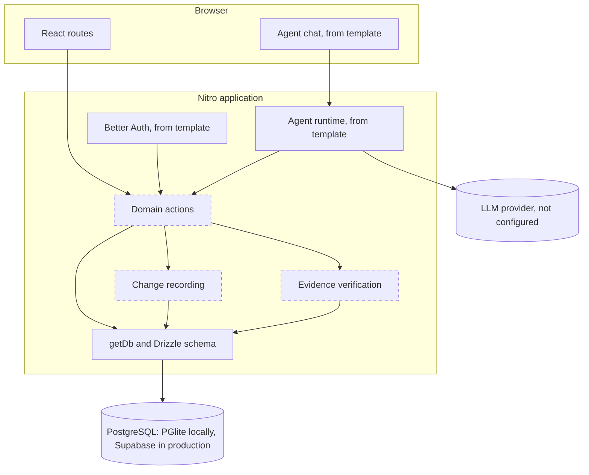
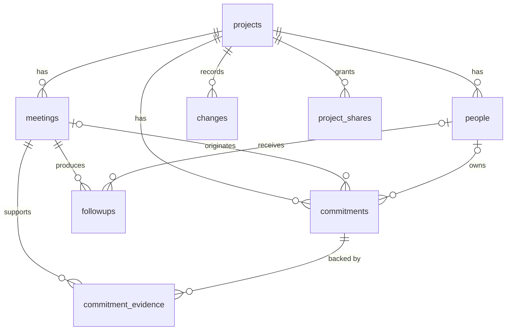
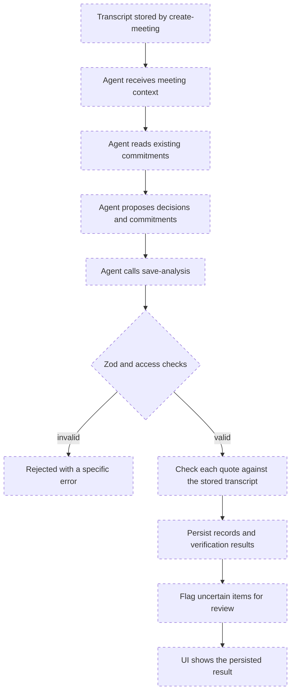
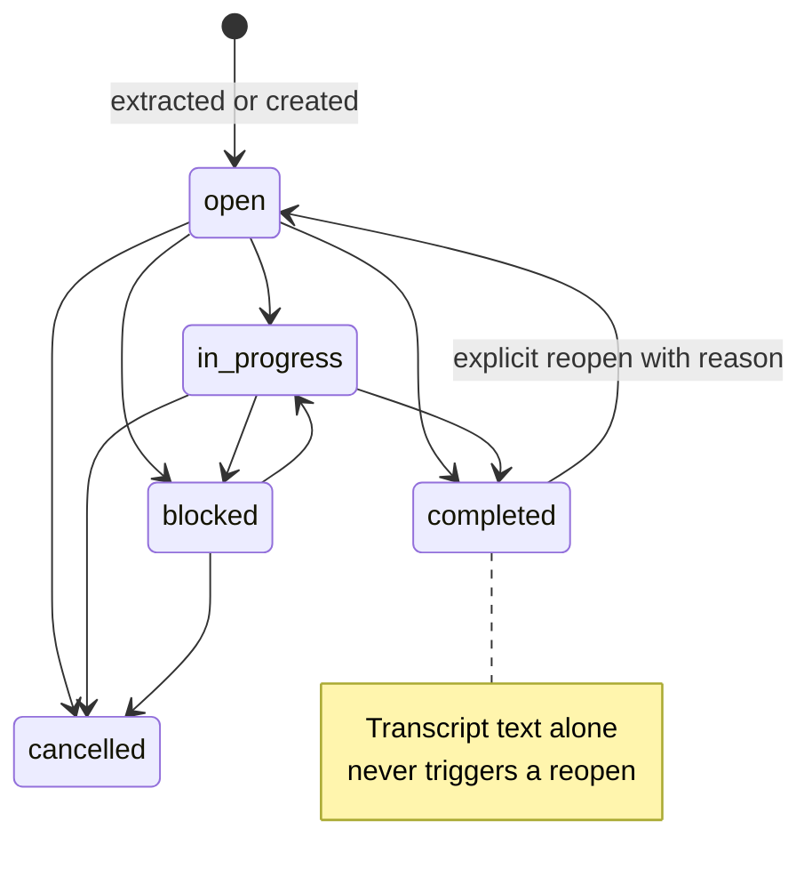
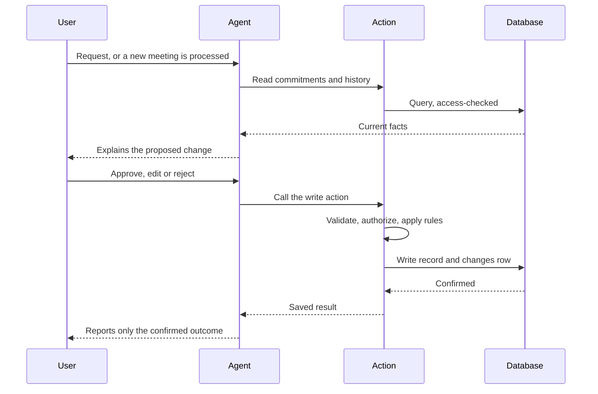

# Architecture

Status as of 2026-11-08, Phase 0. **Implemented** means the code exists now. Everything else is a design for later phases. In diagrams, dashed boxes have not been built.

Framework details were checked against Agent-Native 0.226.0: its documentation, the generated template and the installed package source.

## Modular monolith

One deployable application, organized by domain. There are no separate services, brokers, caches or vector stores. Modules are logical boundaries inside one codebase:

| Module | Tables | State |
| --- | --- | --- |
| projects | `projects`, `project_shares` | Tables implemented |
| people | `people` | Table implemented |
| meetings | `meetings` | Table implemented |
| commitments | `commitments` | Table implemented |
| evidence | `commitment_evidence` | Table implemented |
| ledger | `changes` | Table implemented |
| followups | `followups` | Table implemented |

Where code belongs:

| Concern | Location |
| --- | --- |
| Routes and components | `app/` |
| Agent-exposed and UI operations | `actions/` |
| Reusable business rules, once two actions need them | `server/lib/` |
| Database access | `server/db/` through `getDb()` |
| Shared status values | `shared/domain.ts` |
| Input validation | Zod schema on each action |

## High-level system

## Domain model

- **Commitment** is a single promise with one stable id, however many meetings mention it.
- **Evidence** links a commitment to a quote from a specific meeting. It also serves as the commitment-to-meeting relationship, so no extra join table exists.
- **Person** is someone named in a project. Most people never have an account, so owners are `people` rows and not users.
- **Change** is one recorded modification with before and after state.

Known gap: the user journey extracts **decisions**, but no table exists for them because the initial entity list omitted it. Phase 1 should add one with an additive migration, modeled like commitments with evidence.

## Database architecture

Implemented in `server/db/migrations.ts` (DDL, the single migration owner) and `server/db/schema.ts` (typed queries). The Chat template ships no Drizzle Kit setup, and the framework warns against two migration owners, so constraints live in hand-written SQL. A test fails if Drizzle's columns or the shared status lists drift from it.

Schema design choices:

- **Composite foreign keys** on `(project_id, ...)` make a cross-project reference impossible at the database level.
- **`ON DELETE RESTRICT`** on all historical relationships. The MVP has no hard delete for records with history.
- **`project_shares` cascades** on project deletion because a grant is not history.
- **Dates:** `meeting_date` and `due_date` are calendar dates. Instants are `timestamptz`.

### Invariants

| # | Invariant | Enforced by |
| --- | --- | --- |
| 1 | Commitments have stable identifiers | Primary key. Reuse by matching is a Phase 3 action rule. |
| 2 | Every commitment belongs to a project | `NOT NULL` foreign key |
| 3 | Every meeting belongs to a project | `NOT NULL` foreign key |
| 4 | One commitment can be supported by many meetings | `commitment_evidence` is one-to-many |
| 5 | Owner and due date can be unknown | Nullable columns, tested |
| 6 | Evidence has an explicit verification state | `NOT NULL`, default `unverified`, CHECK. `verified` also requires offsets. |
| 7 | Changes are attributable and auditable | `NOT NULL` actor fields, shape CHECK. **Append-only and trusted actor are planned action rules.** |
| 8 | Completed commitments are not reopened by unrelated text | Partly: `completed_at` must match status. **The reopen rule is planned**, since a database cannot judge relevance. |
| 9 | Deleting a parent never destroys history | `ON DELETE RESTRICT`, tested |
| 10 | Integrity is enforced in the database where practical | Foreign keys, CHECKs, unique indexes, 39 tests |

Rules that only actions can enforce, to be built with their first action:

- `meetings.transcript` cannot change once evidence references it, because offsets index into it.
- `changes` rows are never updated or deleted.
- Status columns with more than two values should use the framework's `defineMachine` with compare-and-set writes, per the template's data guide.

### Access control

| Layer | State |
| --- | --- |
| Sign-in through Better Auth | Implemented by template |
| Ownership columns on `projects` (`owner_email`, `org_id`, `visibility`) | Implemented |
| `project` registered as a shareable resource, `allowPublic: false`, database CHECK rejecting `public` | Implemented |
| Identity-column policy for `people.email` | Implemented |
| `accessFilter` on lists and `assertAccess` before writes in each action | **Planned, Phase 1** |
| Team roles beyond framework sharing | Deferred |

No domain action exists yet, so no route reads or writes domain tables today. Every project-scoped action must check access to its project: child tables have no ownership columns of their own and inherit access through `project_id`.

The framework doctor's `no-unscoped-queries` and `resource-action-access` guards run on every build and help catch mistakes.

## Shared actions

Proposed, not implemented. Files use the framework's `verb-noun` naming, and the filename is the action name.

| Action | Responsibility | Reads or writes |
| --- | --- | --- |
| `create-project` | Create a project owned by the current user | Write |
| `list-projects` | Projects the user can access | Read |
| `create-meeting` | Store a meeting and its original transcript | Write |
| `get-meeting` | Meeting, transcript and extracted results | Read |
| `save-analysis` | Validate and persist the agent's extraction as one operation, verify evidence, flag uncertainty | Write |
| `list-commitments` | Filtered commitments, also used for matching before extraction | Read |
| `update-commitment` | One validated patch for owner, date, description, priority, status | Write |
| `get-ledger` | History for a commitment or project | Read |
| `save-followup` | Create or edit a draft | Write |
| `approve-followup` | Approve a draft, with `needsApproval` for agent callers | Write |
| `undo-change` | Apply a controlled reversal of a recorded change | Write |

Shape of every write action: validate with Zod, check project access, apply business rules, write the record and its `changes` row together, then return the saved result. Direct CRUD actions contain no hidden LLM calls.

`needsApproval` pauses the agent for a person but the framework states it is not an authorization boundary. Access checks are always separate.

The framework also exports resource-history and suggestion-proposal actions under `@agent-native/core/history` and `.../review/suggestions`. Evaluate these in Phase 4 before building a custom proposal flow.

## Agent execution model

`server/plugins/agent-chat.ts` configures the template's runtime. `AGENTS.md` is bundled at build time, so its rules are available on Workers, which has no project filesystem. The runtime exposes each action as a tool. No model is configured yet, so this path is untested.

The LLM interprets and proposes. It never determines authorization, verification status or the actor on a change.

### Transcript processing (planned)

Transcripts are untrusted input. Text inside one can never change instructions, permissions or actor identity.

## Source verification

Planned deterministic server function.

Input: a meeting id and proposed evidence, each a quote with optional offsets. It loads the transcript from the database and never accepts one from the caller.

| Situation | Result |
| --- | --- |
| Offsets given and the substring equals the quote exactly | `verified` |
| No offsets, and the quote occurs exactly once | `verified`, with offsets stored |
| Quote occurs more than once and offsets do not resolve it | `ambiguous` |
| Quote is not in the transcript, or offsets point to different text | `missing` |

Rules:

- Matching is exact. Quotes are never altered to make them pass.
- The server alone sets the result. A caller cannot supply a status.
- `missing` or `ambiguous` evidence sets `needs_review` on the commitment.
- A verified quote proves only that the words were said. It does not prove an inferred assignee or deadline, so those are reviewed separately.
- Text is offset by JavaScript string index, so the transcript must stay unmodified.

## Audit history

`changes` is the product-facing history behind Commitment Trail. It is separate from the framework's automatic action audit, which is operational. Each record stores the entity, operation, actor type, actor id and before and after state.

Actor identity comes from the trusted action context: `ctx.userEmail` for the person, and `ctx.caller` to tell an agent tool call from the UI. It is never read from action input.

## Future undo

`changes.reverts_change_id` links an undo to the change it reverses, and its unique constraint allows only one undo per change. Undo will be a new forward change, leaving history intact. It must refuse when the entity has changed since, instead of overwriting newer work.

## Commitment lifecycle

The status values and the `completed_at` rule are implemented. The transition rules are planned for Phase 1.

Delay and carry-over are derived from evidence and `changes`, not stored as a status, so a slipped commitment keeps its true state.

## Agent modification and approval (planned)

## Error handling

Each failure is handled once, at the boundary responsible for it, with a specific message. Use `fail()` for expected errors. The agent reports failures and never states an unconfirmed success. No silent catches or fabricated defaults.

## Data synchronization

Provided by the framework, with no custom realtime service:

- After each side-effecting agent tool call, the chat run invalidates affected action queries.
- `useDbSync()` is opt-in for changes the viewing user did not initiate. It is likely unnecessary for a single-user demo.
- The `application_state` table carries navigation, so the agent knows what the user is viewing.

## Cloudflare runtime and Supabase connectivity

Full analysis in [DEPLOYMENT.md](DEPLOYMENT.md).

- The database must be external because Workers have no persistent file storage.
- The framework connects through Postgres.js and disables prepared statements for URLs containing `supabase`.
- Migrations never run in Worker request handling. They run from a release step.

## Environment boundaries

| Environment | Database | Auth | Migrations |
| --- | --- | --- | --- |
| Local | PGlite, `data/pglite` | Local dev sign-in | At server startup |
| Tests | In-memory PGlite | None | Applied by the test |
| Production | Supabase | Better Auth with `BETTER_AUTH_SECRET` | `pnpm migrate:production` |

Database URLs and provider keys are server-side only.

## Deployment architecture

